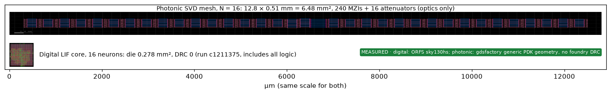
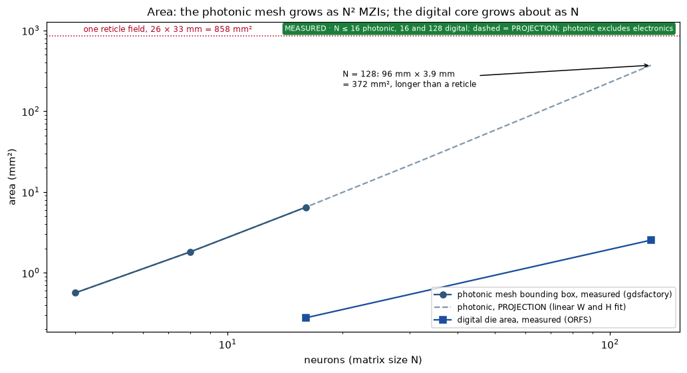
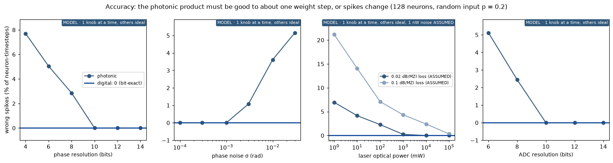
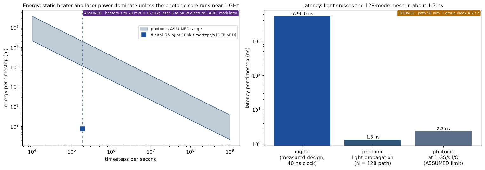

# Photonic MZI mesh against the digital LIF core, same SNN task

Text written in ASD-STE100 Simplified Technical English.

**Verdict.** For the 128-neuron SNN at the speed a robot needs (about 10^5 timesteps per second),
the photonic core loses to the digital core by more than 1,000 times in energy, and it needs about
150 times more area. It is faster: light crosses the mesh in about 1.3 ns, against 5.29 µs per
digital timestep. The photonic core is competitive in energy only near 10^9 timesteps per second,
and only if its static power is at the low end of the assumed range. Its accuracy needs 10-bit
phases, 10-bit ADCs, phase noise below about 1 mrad and watts of laser power. The digital core is
bit-exact.

## Background for beginners

**What a photonic matrix multiplier does.** Light goes into N waveguides. A mesh of
**Mach-Zehnder interferometers (MZIs)** mixes the light between neighbouring waveguides. Each MZI is
two splitters with a heater on one arm. The heater changes the phase of the light, and the phase
sets how much light goes to each output. A mesh of N(N-1)/2 MZIs can make any N × N rotation
matrix (Clements et al. 2016, [arXiv 1603.08788](https://arxiv.org/abs/1603.08788)).

**How a weight matrix goes into light.** Any matrix is W = U × Σ × Vᵀ (singular value
decomposition). U and Vᵀ are rotations, so each is one MZI mesh. Σ is a column of attenuators.
Thus the full product needs 2 × N(N-1)/2 MZIs plus N attenuators.

**Why the sign matters.** A normal photodetector measures light power, which is always positive.
Our weights are from -7 to +7. Thus the design needs **coherent detection**, which measures the
field with a phase reference and keeps the sign. We assume it.

**Why "static" power matters.** A thermal heater must stay on to hold its phase, also when no
spikes arrive. The digital core uses power mostly when its logic switches.

## What we built

| Part | What | File |
|---|---|---|
| Decomposition | SVD + Clements mesh of real Givens rotations, output sign column | `targets/photonic/svd_mesh.py` |
| Model | optical product, then the same integer LIF update as the golden model | `photonic_lif_run()` |
| Tests | reconstruction < 1e-9 up to N = 128 on the real SNN weights; ideal path gives exactly the golden spikes; 3-bit phases break it; laser power changes accuracy | `tests/test_svd_mesh.py` |
| Layout | gdsfactory 9.51.0, generic PDK, cell `mzi2x2_2x2_phase_shifter` (291 × 56 µm), mode pitch 30 µm | `tools/photonic_layout.py` |
| Plots | layout, area, accuracy, energy and latency | `tools/plot_photonic_vs_digital.py` |

The layouts for N = 4, 8 and 16 are in `wiki/raw/assets/photonic/` (GDS and PNG).

## Results

### Layout at the same scale (N = 16)

| | Photonic N = 16 (optics only) | Digital 16 neurons (all logic) |
|---|---|---|
| Size | 12.8 × 0.51 mm = 6.48 mm² | 0.278 mm² die |
| Elements | 240 MZIs, 16 attenuators, 16 sign heaters | 8,887 standard cells; DRC 0 |
| Source | gdsfactory geometry, no foundry DRC | ORFS sky130hs, run c1211375 |

### Area

The photonic length grows with N (2N MZI columns) and its height grows with N (one waveguide per
mode). Thus the area grows as N². At N = 128 the projection is 96 mm × 3.9 mm = 372 mm². 96 mm is
longer than one reticle field (33 mm), so a real design must fold the mesh. The digital die at 128
neurons is 2.54 mm².

### Accuracy

The LIF update compares the membrane with a threshold. An error of about one weight step in the
product can change a spike. For 0 wrong spikes, the model needs about 10-bit phase resolution,
phase noise of 1 mrad or less, a 10-bit ADC and, at 0.02 dB loss per MZI, about 1 to 10 W of optical
power. The light passes 257 MZIs, so at 0.1 dB per MZI the loss is 25.7 dB.

### Energy and latency per timestep

| | Digital (DERIVED, measured run) | Photonic (ASSUMED ranges) |
|---|---|---|
| Energy per timestep at 189,000 timesteps/s | 75 nJ | 114,000 to 2,000,000 nJ |
| Energy per timestep at 10^9 timesteps/s | not possible at this design | 22 to 382 nJ |
| Latency of one timestep | 5,290 ns | about 1.3 ns light path, about 2.3 ns with 1 GS/s I/O |

## Assumptions (photonic)

| Constant | Value | Status |
|---|---|---|
| Heater hold power | 1 to 20 mW per heater, 16,512 heaters at N = 128 | ASSUMED, swept |
| Laser | 1 to 10 W optical, 20% wall-plug, so 5 to 50 W electrical | from the accuracy sweep and ASSUMED efficiency |
| Loss per MZI | 0.02 or 0.1 dB | ASSUMED, swept |
| Detector noise | 1 nW in the signal band | ASSUMED |
| Modulator energy | 0.01 to 1 pJ per input per timestep | ASSUMED |
| Receiver + ADC energy | 1 to 10 pJ per output per timestep | ASSUMED |
| Group index | 4.2 | typical silicon waveguide value |

## What each side includes

| Part | Digital | Photonic |
|---|---|---|
| Synaptic product W × s | yes | yes (optics) |
| LIF update logic | yes | no (needs a digital LIF block) |
| Weight memory | no (external SRAM) | the phases are the memory; their DACs are not in the layout |
| ADCs, modulator drivers, heater DACs | n/a | no |
| Electrical routing and pads | yes | no |
| Foundry DRC | yes, 0 errors | no (generic PDK) |

## What could change the verdict

- **Non-volatile phase shifters** (phase-change or MEMS) remove the static heater power. Then the
  photonic energy falls by orders of magnitude at low timestep rates. This is the strongest lever.
- **Lower loss per MZI** reduces the laser power.
- **Fewer weight levels** (binary or ternary weights) relax the accuracy targets.
- **Larger batch.** Many input vectors through one programmed mesh share the static power.

## Notes

The photonic target in the agent loop (`targets/photonic/mesh.py`) is still the older behavioural
model. Its knobs `laser_mw` and `wavelength_nm` have no effect there (GitHub #6). The new model
gives `laser_mw` a real effect on accuracy.

Related: [ROM against external SRAM](rom-vs-external-sram-weights.md),
[128-neuron core performance](../summaries/128-neuron-core-performance.md),
[glossary](../concepts/glossary.md), [index](../index.md).
