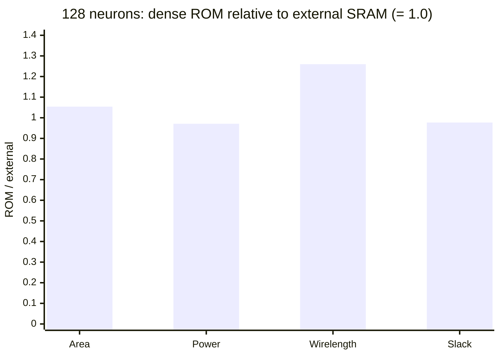

# On-die ROM weights against external SRAM weights, 128 neurons

Text written in ASD-STE100 Simplified Technical English.

**Verdict.** At 128 neurons and fanout 8, ROM weights on the die cost +5.4% area and +26% routed
wirelength. Power is 2.9% lower, and timing is the same within 0.75 ns. The ROM is cheap only
because synthesis removes its zero weights. The external design area does not include its
65,536-bit SRAM. Thus this result does not show that the external-SRAM fabric is better than a
dense ROM. GitHub issue #2.

## Background for beginners

The neuron core needs a weight for each connection from a source neuron to a target neuron. At 128
neurons with 4-bit weights, the full table is 128 × 128 × 4 = 65,536 bits. There are two places to
keep it:

- **External SRAM.** The weights are in a memory outside the core. Each cycle, the core gives an
  address and gets one 512-bit word back one cycle later. The core itself has no weights. This is
  the design that the project uses.
- **On-die ROM.** The weights are fixed in the logic of the core. A ROM is read-only memory. Here
  it is a large `case` statement that synthesis turns into gates.

We changed only the weight store. The state machine, the cycle count and the clock are the same.
The config key is `weight_store: rom` (commit 175c76c).

**Why zeros disappear.** With fanout 8, each neuron gets input from 8 sources out of 128. Thus at
least 94% of the weights are zero. A zero bit in a ROM is a constant. Synthesis removes logic
that only makes constants. A ROM of mostly zeros is therefore small.

## Measured results

Both runs: sky130hs, util 25, clock 40 ns, orchestrated, values from the final-stage keys of
`metadata.json`. Evidence: `runs_digital_e2e/digital/evidence/2026-10-18-rom-baseline-pnr-pass.md`.

| Metric | External SRAM (`f6599c24`) | Dense ROM (`15914a90`) | ROM / external |
|---|---|---|---|
| Design area (mm²) | 0.704933 | 0.743245 | 1.054 |
| Total power (mW) | 14.16 | 13.75 | 0.971 |
| Routed wirelength (um) | 1,449,559 | 1,826,253 | 1.260 |
| Setup slack at 40 ns (ns) | +33.143 | +32.397 | 0.977 |
| DRC | 0 | 0 | |
| Std cells | 81,156 | 86,275 | 1.063 |
| Wall time (min) | 43 | 103 | 2.4 |

At 16 neurons the ratios were 1.035 (area), 1.052 (power), 1.048 (wirelength) and 0.995 (slack).

## What the numbers mean

1. **Area.** The ROM adds 34,247 um² after synthesis for 65,536 bits. The external design must
   also pay for its SRAM, which this comparison does not count. A literature estimate for an OpenRAM
   6T macro of this size on sky130hd is about 0.44 mm² (see
   [CMOS compute-in-memory](../summaries/cmos-compute-in-memory.md)). Thus the ROM design,
   weights included, is probably smaller than the external design plus its SRAM.
2. **Wirelength.** Each ROM word must reach all 128 accumulators. This adds 26% of wire. This is
   the cost that the banked-memory ideas in
   [fractal and hierarchical designs](../summaries/fractal-and-hierarchical-neuromorphic-designs.md)
   try to remove.
3. **Power.** The ROM design uses less power. A possible cause is the switching activity that the
   power tool assumes on the 512 external input pins. Not verified.
4. **Run time.** Detailed routing of the ROM design took about one hour. The full run took 103 min,
   inside the 7200 s timeout.

## What is still open

- **A real dense test.** Set fanout = neurons, so that no weight is zero. Then synthesis cannot
  remove the ROM.
- **The SRAM area.** A fair total needs an SRAM macro for the external design, for example from
  OpenRAM, in the same flow.
- **Power with real activity.** Use a switching-activity file from the parity simulation instead
  of the default.

## Pitfall found on the way

The first 128-neuron ROM run stopped in synthesis with
`Synthesized memory size 4096 exceeds SYNTH_MEMORY_MAX_BITS`. Yosys turns the `case` ROM into one
128 × 510 ROM memory (65,280 bits), and ORFS refuses memories above 4096 bits by default. Commit
1968f2e raises the limit to the ROM size for ROM designs. Do not use `SYNTH_MOCK_LARGE_MEMORIES`.
It makes the memory one row and fakes the result.

Related: [ENG-009](../incidents/009-copy-out-path-and-no-metadata.md),
[ENG-010](../incidents/010-parse-metrics-took-cts-stage-values.md), [index](../index.md).
