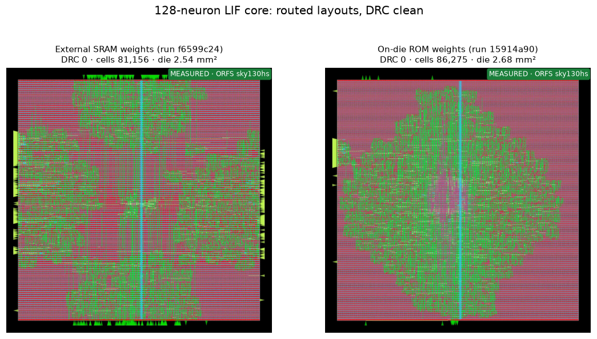
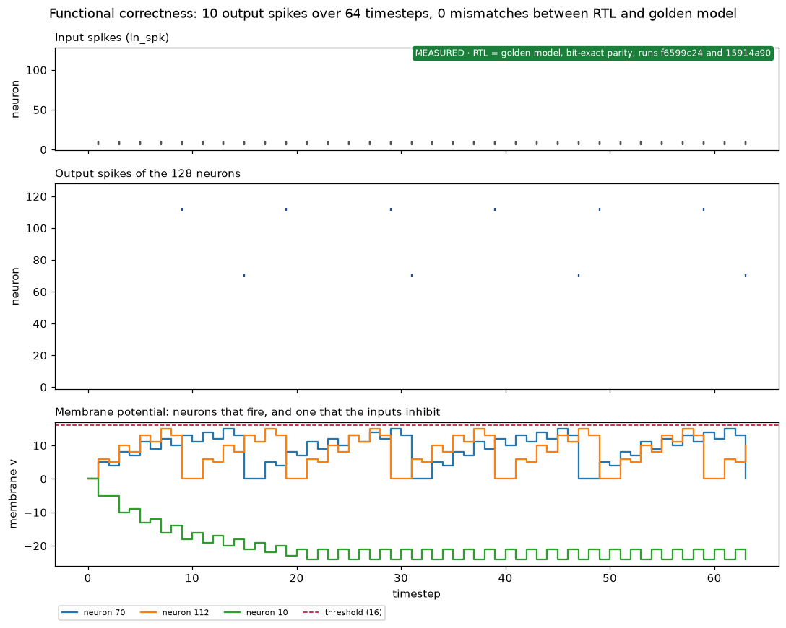
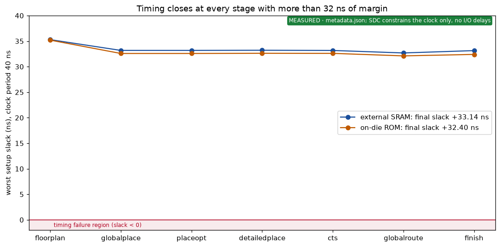
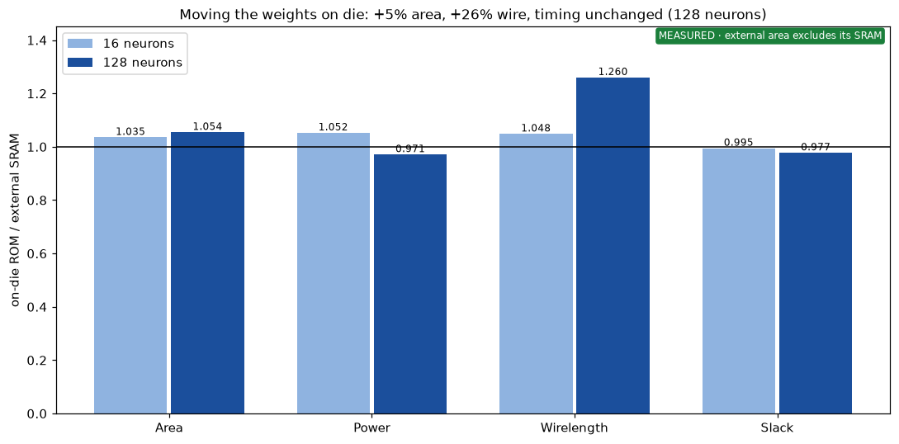
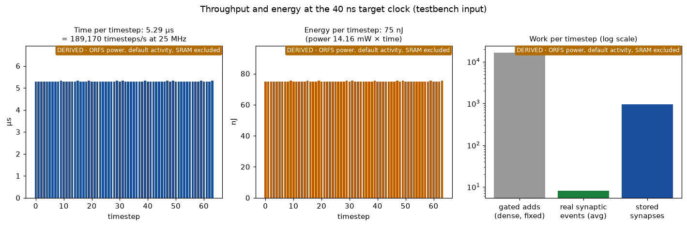
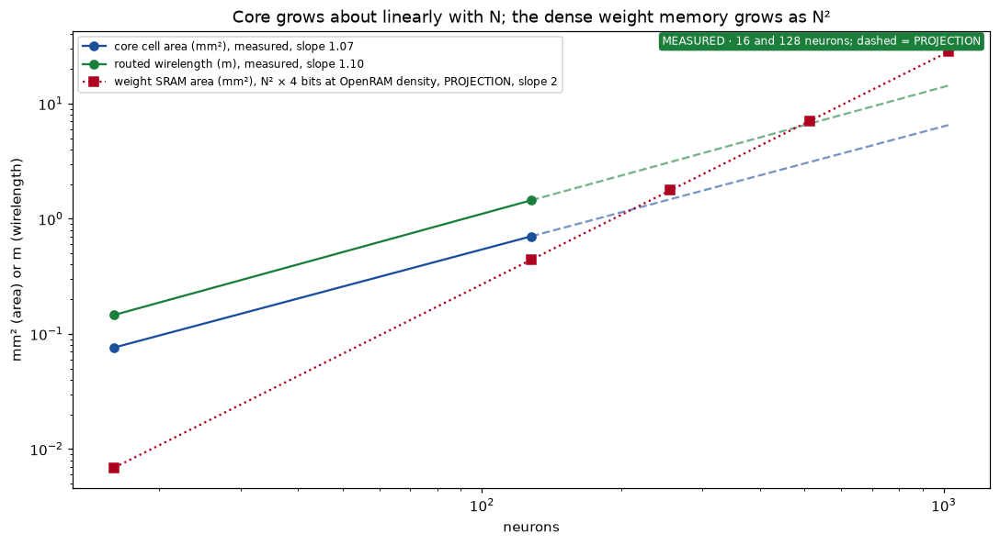

# 128-neuron core performance in plots

Text written in ASD-STE100 Simplified Technical English.

This page shows what the 128-neuron LIF core does today, in six plots. Each plot has a label on
the image:

- **MEASURED**: from a flow run or from a parity-checked simulation.
- **DERIVED**: arithmetic on measured values.
- **PROJECTION**: a line outside the measured points.

`tools/plot_performance.py` makes all plots from files in git. Run it again after a new flow run.

## What we can claim

1. **It works.** The RTL matches the golden model bit for bit (parity test), and both layouts have
   0 DRC errors.
2. **Timing closes with a large margin.** The final setup slack is +33.1 ns at a 40 ns clock.
3. **The flow is deterministic.** Two runs of one config gave the same area, wirelength and slack.
4. **The agent loop runs end to end.** Both runs came from the orchestrator, with a journal line.

We do **not** claim that the core is more efficient than other chips. See "Limits" below.

## 1. Layouts

External SRAM weights (run `f6599c24`) and on-die ROM weights (run `15914a90`). sky130hs, 25%
utilization.

## 2. Functional correctness

The input is the parity testbench pattern: sources 7, 8 and 9 spike in every second timestep. The
RTL gave the same spikes as the golden model in both orchestrated runs. With this sparse input, 2
neurons fire (10 spikes in 64 timesteps). Neuron 10 gets negative weights from the same inputs and
stays below rest.

## 3. Timing by stage

## 4. Weights on die against external weights

See [ROM against external SRAM](../comparisons/rom-vs-external-sram-weights.md).

## 5. Throughput and energy

| Value | Result | How |
|---|---|---|
| Time per timestep | 5.29 µs | (128 + 4 + spikes) cycles × 40 ns, ±1 cycle |
| Timesteps per second | about 189,000 | 1 / 5.29 µs |
| Energy per timestep | about 75 nJ | 14.16 mW × 5.29 µs |
| Gated adds per timestep | 16,384 | 128 words × 128 accumulators, for each input |
| Stored synapses | about 1,000 | fanout 8 × 128 |
| Real synaptic events per timestep | 8 on average | testbench input only |

## 6. Scaling

Core area grows with slope 1.07 and wirelength with slope 1.10 from 16 to 128 neurons (two measured
points). A dense weight memory grows as N². At OpenRAM density on sky130hd, it passes the core area
between 128 and 256 neurons. The dashed lines are projections.

## Limits

- **Power is an estimate.** ORFS uses default switching activity, not the activity of a real
  simulation. The external SRAM is not included.
- **No maximum clock claim.** The SDC sets only the clock. It sets no input or output delays, so
  the 512-bit weight port is not timed. The slack covers paths inside the core only.
- **The core reads all 128 words in each timestep.** Thus the energy per timestep does not fall
  with fewer input spikes. Most of the 16,384 adds add zero.
- **No comparison with published chips.** They use other nodes (14 to 28 nm against 130 nm),
  measured power and their own memories.

For how the core would connect to a robot arm, see
[robot integration over SPI](../tasks/musings/2026-10-19-edge-robot-integration-spi-not-pcie.md) (GitHub #13).

Related: [glossary](../concepts/glossary.md), [tutorial 3](../tutorials/reading-ppa-metrics.md),
[index](../index.md).
